<div align="center">
  

  <br/><br/>

  <a href="https://mrwhiitehat.github.io/mrwhitehat-3d-portfolio/">
    
  </a>
  &nbsp;
  <a href="https://github.com/MrWhiiteHat?tab=repositories">
    
  </a>

</div>

<br/>

<!-- ─────────────────────────────────────────── -->

### `> whoami`

<table>
  <tr>
    <td valign="top" width="55%">
      <p>Cybersecurity researcher and AI engineer building LLM-powered security tools, autonomous AI agents, and full-stack applications.</p>
      <table>
        <tr>
          <td>📍 <b>Location</b></td>
          <td>Odisha, India</td>
        </tr>
        <tr>
          <td>🎓 <b>Education</b></td>
          <td>B.Tech — Computer Science & Engineering</td>
        </tr>
        <tr>
          <td>🔭 <b>Focus</b></td>
          <td>AI Agents · AppSec · LLM Systems</td>
        </tr>
        <tr>
          <td>⚡ <b>Building</b></td>
          <td>Security tools with autonomous AI</td>
        </tr>
        <tr>
          <td>💬 <b>Ask me about</b></td>
          <td>Mobile security, RAG pipelines, AI agents</td>
        </tr>
      </table>
    </td>
    <td valign="top" width="45%">
      <h4>🏆 Achievements & Work</h4>
      <br/>
      <br/>
      <br/>
      <br/>
      <br/>
      
    </td>
  </tr>
</table>

### `> currently`

```python
class MrWhiteHat:
    currently_working_on = "LLM-powered mobile security analysis platform"
    learning = ["Advanced agentic workflows", "Multi-agent orchestration"]
    looking_to_collaborate_on = "AI + Security open-source projects"
    fun_fact = "I reverse engineer apps for fun 🔓"
```


<!-- ─────────────────────────────────────────── -->

### `> tech_stack`

<div align="center">

**Languages**


**AI / ML**


**Development**


**Data & Infrastructure**


**Security**


</div>

<br/>

<!-- ─────────────────────────────────────────── -->

### `> featured_projects`

<table>
  <tr>
    <td width="50%" valign="top">
      <h3><a href="https://github.com/MrWhiiteHat/LLM-Powered-Autonomous-Mobile-Application-Security-Penetration-Testing-Platform">🛡️ Mobile Security Agent</a></h3>
      <p>Autonomous, privacy-preserving mobile app penetration testing platform. 10-phase security pipeline with local RAG engine and LLM reasoning. Aligned with OWASP Mobile Top 10.</p>
      <p>
        
        
        
        
      </p>
    </td>
    <td width="50%" valign="top">
      <h3><a href="https://github.com/MrWhiiteHat/KSecurity-Ai-Intelligence-Discord-bot">🤖 AegisAI</a></h3>
      <p>AI-powered multi-agent content intelligence and Discord moderation platform. Autonomous agents for community safety, threat analysis, and content moderation.</p>
      <p>
        
        
        
        
      </p>
    </td>
  </tr>
  <tr>
    <td width="50%" valign="top">
      <h3><a href="https://github.com/MrWhiiteHat/Real-VS-Fake-Dectection-">🔍 RealFake Detection</a></h3>
      <p>AI-powered deepfake detection system using computer vision and deep learning techniques for real-time media authenticity verification.</p>
      <p>
        
        
        
        
      </p>
    </td>
    <td width="50%" valign="top">
      <h3><a href="https://github.com/MrWhiiteHat/AI-Powered-Agricultural-Advisory-Chatbot-for-Indian-Farmers">🌾 KrishiMitra</a></h3>
      <p>AI-powered agricultural advisory chatbot for Indian farmers. Crop disease detection, multilingual voice support, weather updates, mandi prices, and government schemes.</p>
      <p>
        
        
        
        
      </p>
    </td>
  </tr>
</table>

<div align="center">
  <br/>
  <a href="https://mrwhiitehat.github.io/mrwhitehat-3d-portfolio/">
    
  </a>
  <sub>&nbsp;&nbsp;First-person Three.js workspace · React + R3F + Vite · Live CTOS telemetry</sub>
</div>

<br/>

<!-- ─────────────────────────────────────────── -->

### `> stats`

<div align="center">

  
  &nbsp;
  

  <br/><br/>

  

  <br/><br/>

  <!-- 🐍 Snake eating contributions — generated by GitHub Action -->
  <picture>
    <source media="(prefers-color-scheme: dark)" srcset="https://raw.githubusercontent.com/MrWhiiteHat/MrWhiiteHat/output/snake-dark.svg"/>
    <source media="(prefers-color-scheme: light)" srcset="https://raw.githubusercontent.com/MrWhiiteHat/MrWhiiteHat/output/snake.svg"/>
    
  </picture>

</div>

<br/>


<!-- ─────────────────────────────────────────── -->

### `> connect`

<div align="center">

  [](https://github.com/MrWhiiteHat)
  &nbsp;
  [](https://linkedin.com/in/)
  &nbsp;
  [](mailto:kanhasarangi39@gmail.com)
  &nbsp;
  [](https://mrwhiitehat.github.io/mrwhitehat-3d-portfolio/)

</div>

<br/>

<div align="center">
  <sub><code>> BUILDING INTELLIGENT SYSTEMS. EXPLORING WHAT'S NEXT.</code></sub>
  <br/><br/>
  
</div>

<!-- README.md — MrWhiiteHat | Sadashiba Sarangi -->
