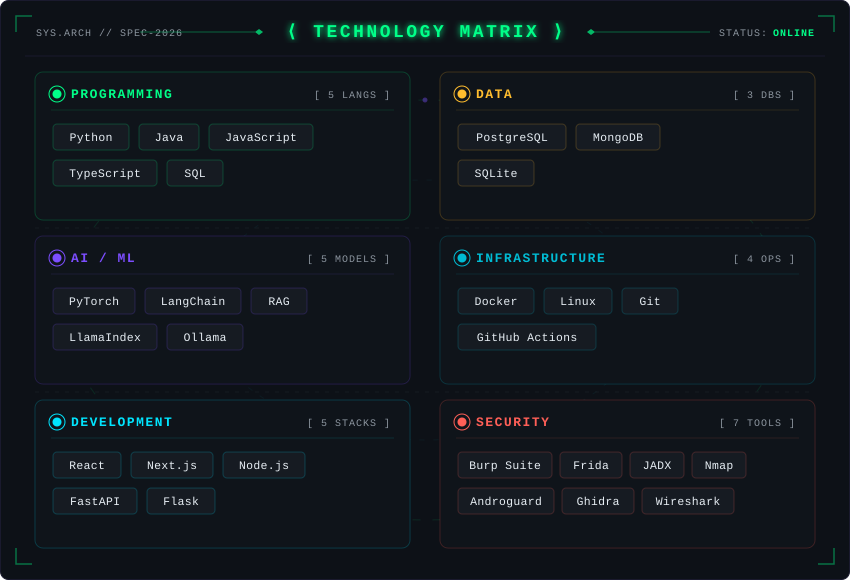

  <!-- ============================================================ -->
  <!-- HERO BANNER                                                  -->
  <!-- ============================================================ -->
  

   
  
  

    <code>[ SYSTEM STATUS: ONLINE ] &bull; AI ARCHITECTURE &bull; DEFENSIVE CYBERNETICS &bull; APPLIED REVERSE ENGINEERING</code>
  

  <!-- ============ PORTFOLIO CTA ============ -->
   

  
  &nbsp;&nbsp;
  

    

  <code>Sadashiba Sarangi &bull; B.Tech CSE &bull; Odisha, India &bull; 58+ Followers</code>

  

<!-- ============================================================ -->
<!-- SECTION: ABOUT                                               -->
<!-- ============================================================ -->
<h2 align="center">⟨ SYSTEM.IDENTITY ⟩</h2>

  

 

  

<!-- ============================================================ -->
<!-- SECTION: TECH MATRIX                                         -->
<!-- ============================================================ -->
<h2 align="center">⟨ TECHNOLOGY.MATRIX ⟩</h2>

  
    
  

 

  

<!-- ============================================================ -->
<!-- SECTION: MISSION CONTROL                                     -->
<!-- ============================================================ -->
<h2 align="center">⟨ MISSION.CONTROL ⟩</h2>

  <code>Active operations and research initiatives</code>

  

    

  

    

  

    

  <!-- BONUS: KrishiMitra -->
  

 

  

<!-- ============================================================ -->
<!-- SECTION: 3D PORTFOLIO SHOWCASE                               -->
<!-- ============================================================ -->
<h2 align="center">⟨ DIGITAL.WORKSPACE ⟩</h2>

  

    

  
  &nbsp;
  

    
  <code>First-person 3D workspace &bull; React + Three.js + R3F &bull; CTOS Telemetry &bull; Cyber Stations</code>

 

  

<!-- ============================================================ -->
<!-- SECTION: SYSTEM ANALYTICS                                    -->
<!-- ============================================================ -->
<h2 align="center">⟨ SYSTEM.ANALYTICS ⟩</h2>

<!-- GitHub Stats - powered by external services. May occasionally be unavailable. -->

  <table>
    <tr>
      <td align="center" valign="middle">
        
      </td>
      <td align="center" valign="middle">
        
      </td>
    </tr>
  </table>

   

  

    

  

 

  

<!-- ============================================================ -->
<!-- SECTION: ESTABLISH CONNECTION                                -->
<!-- ============================================================ -->
<h2 align="center">⟨ ESTABLISH.CONNECTION ⟩</h2>

  
  
    

  <!-- Interactive Quick Links -->
  

    
    &nbsp;
    <!-- UPDATE: Replace with actual LinkedIn profile URL -->
    
    &nbsp;
    
    &nbsp;
    
  

 

<!-- ============================================================ -->
<!-- SECTION: FOOTER                                              -->
<!-- ============================================================ -->

  
  
    

  <!-- Profile View Telemetry Counter -->
  

    

  

    <code>// MRWHIITEHAT NODE SECURE &bull; TRANSMISSION COMPLETED //</code>
  

<!-- README.md — MrWhiiteHat | Sadashiba Sarangi | Last generated: auto-updated -->
